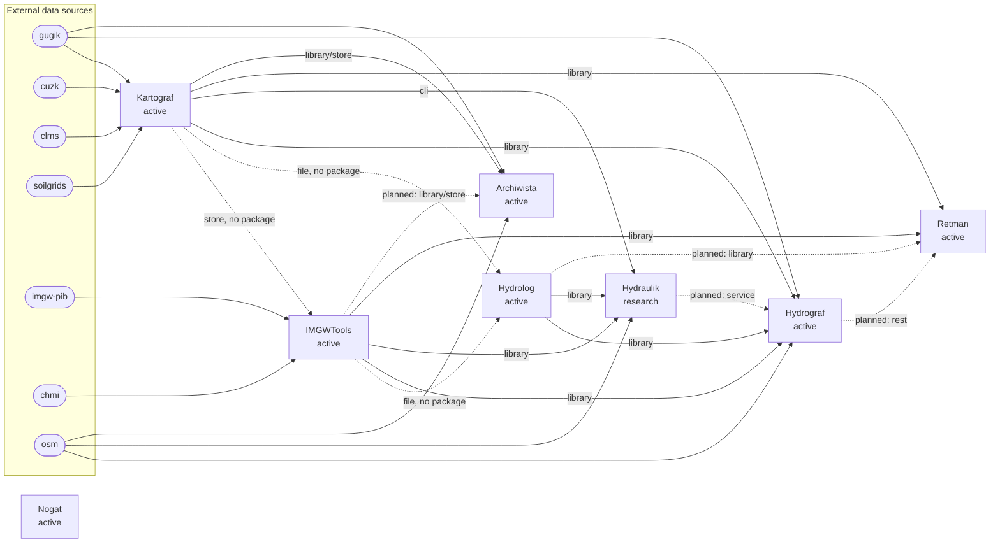

# Ecosystem map

<!-- Generated by `uv run scripts/ecosystem.py map` from ecosystem.yaml. Do not edit. -->

Projects, dependencies and data exchanged between them. Source of truth:
[`ecosystem.yaml`](../ecosystem.yaml) (standard
2.1, [ECOSYSTEM_HUB](../standards/ECOSYSTEM_HUB.md)).

## Data flow

Arrows run from producer to consumer and carry the transport. Dotted
arrows are planned dependencies or file and store exchanges without a
package dependency (labelled).

## Projects

| Project | Profiles | Status | Summary |
|---|---|---|---|
| [Nogat](https://github.com/Daldek/Nogat) | hub | active | Ecosystem hub with standards, registry and map; future user package installing all tools. |
| [Kartograf](https://github.com/Daldek/Kartograf) | tool | active | Downloads Polish and Czech geodata (DEM, imagery, land cover, soil) as plain files or a store. |
| [IMGWTools](https://github.com/Daldek/IMGWTools) | tool, app | active | IMGW-PIB and ČHMÚ hydro-meteo data, PMAXTP; plain files or a versioned store with Parquet series. |
| [Hydrolog](https://github.com/Daldek/Hydrolog) | tool | active | Hydrological calculations (tc, SCS-CN, unit hydrographs, statistics, HSG) as library, CLI and MCP. |
| [Hydrograf](https://github.com/Daldek/Hydrograf) | app | active | Web app (FastAPI + PostGIS) for watershed delineation and design hydrographs. |
| [Hydraulik](https://github.com/Daldek/Hydraulik) | tool | research | 2D hydraulic flood screening with Deltares SFINCS; research stage. |
| [Retman](https://github.com/Daldek/Retman) | tool | active | Polish natural-language command layer over the ecosystem tools. |
| [Archiwista](https://github.com/Daldek/Archiwista) | app | active | Web browser and manager of Kartograf and IMGWTools stores. |

## Dependencies and exchanged data

| Consumer | Producer | Kind | Status | Via | Exchanged data |
|---|---|---|---|---|---|
| IMGWTools | Kartograf | data | active | store | `kartograf-store` |
| Hydrolog | IMGWTools | data | active | file | `imgw-series-csv` |
| Hydrolog | Kartograf | data | active | file | `kartograf-files` |
| Hydrograf | Kartograf | runtime | active | library | `kartograf-files`, `kartograf-meta/1` |
| Hydrograf | Hydrolog | runtime | active | library | `watershed-parameters`, `hydrolog-python-api` |
| Hydrograf | IMGWTools | runtime | active | library | `imgw-pmaxtp` |
| Hydrograf | Hydraulik | runtime | planned | service | `hydraulik-job` |
| Hydraulik | Kartograf | runtime | active | cli | `kartograf-files` |
| Hydraulik | IMGWTools | runtime | active | library | `imgw-pmaxtp` |
| Hydraulik | Hydrolog | runtime | active | library | `hydrolog-python-api` |
| Retman | Kartograf | optional | active | library | `kartograf-command-list/1`, `kartograf-commands/1`, `kartograf-result/1`, `kartograf-download/1`, `kartograf-error/1`, `kartograf-meta/1` |
| Retman | IMGWTools | optional | active | library | `imgw-command-list/1`, `imgw-commands/1`, `imgw-result/1`, `imgw-plan/1`, `imgw-project/1`, `imgw-store/1`, `imgw-archives`, `imgw-series-csv`, `imgw-testing` |
| Retman | Hydrolog | optional | planned | library | `hydrolog-catalog`, `hydrolog-result/1` |
| Retman | Hydrograf | optional | planned | rest | `hydrograf-rest` |
| Archiwista | Kartograf | runtime | active | library, store | `kartograf-store`, `kartograf-meta/1`, `kartograf-project/1`, `kartograf-plan/1` |
| Archiwista | IMGWTools | optional | planned | library, store | `imgw-store/1`, `imgw-meta/1`, `imgw-series/1`, `imgw-project/1`, `imgw-observation/1`, `chmi-json/1` |

### Details

- **IMGWTools → Kartograf**: No import; refuses a store nested in another, and a plain output directory inside one, by marker file name (DEV-19.11, DEV-19.12, DEV-19.14), as Kartograf does with imgw-store.json. Hard-link publication model follows Kartograf ADR-036.
- **Hydrolog → IMGWTools**: No package dependency; stats commands read series CSV exported by `imgw series export`.
- **Hydrolog → Kartograf**: No package dependency; `soil hsg` reads SoilGrids clay, sand and silt GeoTIFFs. HSG rules ported from Kartograf (Hydrolog ADR-025).
- **Hydrograf → Kartograf**: uses `DownloadManager`, `GugikProvider`, `MetadataCache`, `LandCoverManager`, `Bdot10kProvider`, `HSGCalculator`, `SheetParser`, `find_sheets_for_bbox`, `find_sheets_for_geometry`
- **Hydrograf → Hydrolog**: uses `WatershedParameters`, `ConcentrationTime`, `HydrographGenerator`, `NashIUH`, `BetaHietogram`, `BlockHietogram`, `EulerIIHietogram`
- **Hydrograf → IMGWTools**: uses `fetch_pmaxtp`
- **Hydrograf → Hydraulik**: Hydraulik as an external compute node fed with a catchment domain.
- **Hydraulik → Kartograf**: Calls `kartograf download` as a subprocess for DEM and BDOT10k.
- **Hydraulik → IMGWTools**: uses `fetch_pmaxtp`
- **Hydraulik → Hydrolog**: uses `BetaHietogram`, `EulerIIHietogram`
- **Retman → Hydrolog**: Retman PRD roadmap.
- **Retman → Hydrograf**: Retman PRD roadmap.
- **Archiwista → Kartograf**: uses `list_segments`, `list_partitions`, `iter_store`, `read_sidecar`, `describe_segment`, `file_footprint`, `link_target`, `pinned_transform`, `open_project`, `get_project_status`; Contract KA-1..KA-8 (Archiwista SPEC §12); KB..KG planned.
- **Archiwista → IMGWTools**: Extra archiwista[imgw] (IMGW-1..14); ČHMÚ (IMGW-15..19).

## What each project provides

### Kartograf

| Id | Kind | Consumers | Description |
|---|---|---|---|
| `kartograf-files` | dataset | Hydrolog, Hydrograf, Hydraulik | Downloaded rasters and vectors (ASC/GeoTIFF DEM, GeoPackage BDOT10k, SoilGrids and HSG GeoTIFF, LAZ), as plain files under their store names (--output-dir, DEV-19.5) or as store versions. |
| `kartograf-meta/1` | sidecar | Hydrograf, Retman, Archiwista | &lt;file&gt;.meta.json next to every stored file, none in plain mode: CRS, nodata, source, licence, request, parent_request, SHA-256, producer, producer_version. |
| `kartograf-store` | store | IMGWTools, Archiwista | Versioned store (versions/&lt;label&gt;_&lt;sha8&gt;/, hard-linked current path) with root marker kartograf-store.json (schema kartograf-store/1, DEV-19.12), default root &lt;data_dir&gt;/kartograf, kartograf store init, and read API list_segments, iter_store, read_sidecar, file_footprint (keyword root). |
| `kartograf-project/1` | manifest | Archiwista | kartograf-project.json pinning store versions by SHA-256, with the store root. |
| `kartograf-download/1` | document | Retman | Download report: files[] {path, size_bytes, sha256, status}, failed[], skipped[], notices, mode plain or store; also for land cover, soil, HSG and collections. |
| `kartograf-plan/1` | document | Archiwista | Plan without effects (--check) per file; current, newer, missing or unverifiable in the store, write, replace or conflict in plain mode. |
| `kartograf-availability/1` | document | — | Years, systems, resolutions and completeness of DEM coverage for an area. |
| `kartograf-command-list/1` | catalog | Retman | Summary of every command (name, operation_id, effects, check twin) from list_commands and kartograf commands list; the first step of discovery. |
| `kartograf-commands/1` | catalog | Retman | One command with options, rules, errors and examples (command_schema, kartograf commands schema) behind CLI and MCP, with validate_command, run_command, check_command, format_command. |
| `kartograf-result/1` | document | Retman | Result envelope of every command (status ok, partial or failed, domain result, items, notices); exit codes 0, 10 and 11. |
| `kartograf-error/1` | document | Retman | Error document with code, hint and exit code, the last line of stderr. |
| `kartograf-testing` | library | — | kartograf.testing builds stores, projects and sidecars with the real writers, offline, for the contract tests of consumers (DEV-10.6). |

### IMGWTools

| Id | Kind | Consumers | Description |
|---|---|---|---|
| `imgw-store/1` | store | Retman, Archiwista (planned) | Versioned store (archives, stations, series) with root marker imgw-store.json (tool, created_at, producer_version, DEV-19.12), default root &lt;data_dir&gt;/imgw (IMGW_ROOT), imgw store init, and read API store_info, iter_store, read_meta, read_series. |
| `imgw-meta/1` | sidecar | Archiwista (planned) | Archive sidecar with dataset, provider, licence, HTTP signals, SHA-256 and content_sha256. |
| `imgw-series/1` | dataset | Archiwista (planned) | Parquet series per station with series.json index (periods, year type, units, coverage). |
| `imgw-project/1` | manifest | Retman, Archiwista (planned) | imgw-project.json pinning store versions by SHA-256 or content hash. |
| `imgw-plan/1` | document | Retman | Plan without effects (--check) for archives, series and catalog in the store, and write, replace or conflict per file in plain mode. |
| `imgw-observation/1` | document | Archiwista (planned) | History of published HTTP signals per archive file. |
| `chmi-json/1` | document | Archiwista (planned) | Canonical JSON form of ČHMÚ files used for content-based pins. |
| `imgw-result/1` | document | Retman | Result envelope of every command (status, result, errors, notices, exit code); a writing command lists files[] {path, size_bytes, sha256, status}. |
| `imgw-command-list/1` | catalog | Retman | Summary of every command (name, operation_id, group, effects, check twin, REST route) from list_commands and imgw commands list. |
| `imgw-commands/1` | catalog | Retman | One command with options, x-imgw metadata and errors (command_schema, imgw commands schema) behind CLI, REST and MCP, with validate_command, run_command, check_command, format_command. |
| `imgw-archives` | dataset | Retman | IMGW-PIB and ČHMÚ archive files as published (ZIP, CSV, JSON), as plain files under their server path (datasets download --output-dir) or as store versions. |
| `imgw-series-csv` | dataset | Hydrolog, Retman | CSV export of series with units and IMGW-PIB attribution (series export --output FILE). |
| `imgw-pmaxtp` | document | Hydrograf, Hydraulik | PMAXTP design precipitation quantiles per grid cell (fetch_pmaxtp, PMaXTPResult). |
| `imgw-testing` | library | Retman | imgwtools.testing builds an offline store (archives, series, catalog) with the real writers and the marker, for the contract tests and probes of consumers (DEV-10.6). |

### Hydrolog

| Id | Kind | Consumers | Description |
|---|---|---|---|
| `watershed-parameters` | document | Hydrograf | WatershedParameters JSON (area, perimeter, length, elevations, CN, slopes) as calculation input. |
| `hydrolog-hsg` | dataset | — | HSG raster (uint8 GeoTIFF, groups A–D) and HSG statistics from clay, sand and silt rasters. |
| `hydrolog-result/1` | document | Retman (planned) | Result envelope (command, inputs, result, files with SHA-256, notices). |
| `hydrolog-error/1` | document | — | Error envelope with registry code, details and hint. |
| `hydrolog-catalog` | catalog | Retman (planned) | Catalog of commands behind CLI, MCP and hydrolog.operations (run_command). |
| `hydrolog-python-api` | library | Hydrograf, Hydraulik | Calculation classes (ConcentrationTime, HydrographGenerator, NashIUH, BetaHietogram, EulerIIHietogram). |

### Hydrograf

| Id | Kind | Consumers | Description |
|---|---|---|---|
| `hydrograf-rest` | service | Retman (planned) | REST API with watershed boundary GeoJSON, morphometry JSON, hydrograph Q(t) and CSV exports; MVT tiles. |

### Hydraulik

| Id | Kind | Consumers | Description |
|---|---|---|---|
| `hydraulik-job` | contract | Hydrograf (planned) | Planned hydraulik.spec contracts (JobSpec, InputBundle, RunStatus, ResultManifest) and web products. |

### Archiwista

| Id | Kind | Consumers | Description |
|---|---|---|---|
| `archiwista-rest` | service | — | REST API /api/v1 (catalog, map footprints, projects, previews, jobs with SSE). |
| `archiwista-sources` | contract | — | Source adapter protocol registered through the archiwista.sources entry point. |

## External data sources

Direct access only; data obtained through another project is shown in the
data-flow diagram.

| Source | Country | Licence | Accessed directly by |
|---|---|---|---|
| [GUGiK (Główny Urząd Geodezji i Kartografii)](https://www.geoportal.gov.pl) | PL | free reuse with attribution (Prawo geodezyjne i kartograficzne) | Kartograf, Hydrograf, Archiwista |
| [ČÚZK (Český úřad zeměměřický a katastrální)](https://geoportal.cuzk.cz) | CZ | CC BY 4.0 | Kartograf |
| [Copernicus Land Monitoring Service (CORINE Land Cover)](https://land.copernicus.eu) | EU | Copernicus data policy, attribution required | Kartograf |
| [ISRIC SoilGrids](https://soilgrids.org) | global | CC BY 4.0 | Kartograf |
| [IMGW-PIB (archives, live API, PMAXTP atlas)](https://danepubliczne.imgw.pl) | PL | IMGW-PIB terms of reuse, attribution required | IMGWTools |
| [ČHMÚ open data](https://opendata.chmi.cz) | CZ | CC BY 4.0 | IMGWTools |
| [OpenStreetMap](https://www.openstreetmap.org) | global | ODbL | Hydrograf, Hydraulik, Archiwista |
