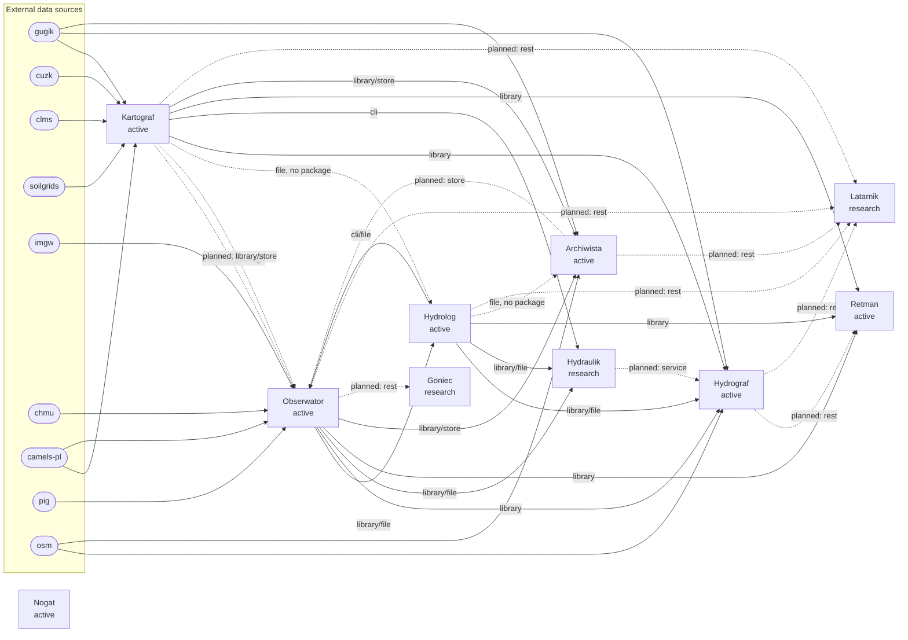

# Ecosystem map

<!-- Generated by `uv run scripts/ecosystem.py map` from ecosystem.yaml. Do not edit. -->

Projects, dependencies and data exchanged between them. Source of truth:
[`ecosystem.yaml`](../ecosystem.yaml) (standard
1.3, [ECOSYSTEM_HUB](../standards/ECOSYSTEM_HUB.md)).

## Data flow

Arrows run from producer to consumer and carry the transport. Dotted
arrows are planned dependencies or file and store exchanges without a
package dependency (labelled).

## Projects

| Project | Profiles | Status | Summary |
|---|---|---|---|
| [Nogat](https://github.com/Daldek/Nogat) | hub | active | Ecosystem hub with standards, registry and map; future user package installing all tools. |
| [Kartograf](https://github.com/Daldek/Kartograf) | tool | active | Downloads Polish and Czech geodata (DEM, imagery, land cover, soil) as plain files or a store. |
| [Obserwator](https://github.com/Daldek/Obserwator) | tool, app | active | IMGW-PIB and ČHMÚ hydro-meteo data, PMAXTP; plain files or a versioned store with Parquet series. |
| [Hydrolog](https://github.com/Daldek/Hydrolog) | tool | active | Hydrologic calculations (tc, SCS-CN, hydrographs, routing, statistics, HSG); library, CLI, MCP, GUI. |
| [Hydrograf](https://github.com/Daldek/Hydrograf) | app | active | Web app (FastAPI + PostGIS) for watershed delineation and design hydrographs. |
| [Hydraulik](https://github.com/Daldek/Hydraulik) | tool | research | Builds and runs SFINCS flood models from terrain and design rain; optional EPA SWMM sewer coupling. |
| [Retman](https://github.com/Daldek/Retman) | tool | active | Polish natural-language command layer over Kartograf, Obserwator and Hydrolog. |
| [Archiwista](https://github.com/Daldek/Archiwista) | app | active | Web browser and manager of Kartograf and Obserwator stores. |
| [Goniec](https://github.com/Daldek/Goniec) | plugin | research | QGIS plugin over the tools' servers; 0.1 shows Obserwator's stations, current data and series. |
| [Latarnik](https://github.com/Daldek/Latarnik) | app | research | Optional access point and GUI hub of a deployment; routes, limits and caches the tools' servers. |

## Dependencies and exchanged data

| Consumer | Producer | Kind | Status | Via | Exchanged data |
|---|---|---|---|---|---|
| Obserwator | Kartograf | data | active | store | `kartograf-store/1` |
| Obserwator | Kartograf | optional | planned | library, store | `kartograf-camels-pl`, `kartograf-store/1`, `kartograf-meta/1` |
| Obserwator | Archiwista | data | planned | store | `archiwista-raw-root` |
| Obserwator | Hydrolog | optional | active | cli, file | `hydrolog-result/1`, `hydrolog-series/1` |
| Hydrolog | Obserwator | optional | active | library, file | `obserwator-pmaxtp`, `obserwator-series-csv` |
| Hydrolog | Kartograf | data | active | file | `kartograf-files` |
| Hydrograf | Kartograf | runtime | active | library | `kartograf-files`, `kartograf-meta/1` |
| Hydrograf | Hydrolog | runtime | active | library, file | `watershed-parameters`, `hydrolog-python-api`, `hydrolog-network/1` |
| Hydrograf | Obserwator | runtime | active | library | `obserwator-pmaxtp` |
| Hydrograf | Hydraulik | runtime | planned | service | `hydraulik-job` |
| Hydraulik | Kartograf | optional | active | cli | `kartograf-files`, `kartograf-commands/1`, `kartograf-result/1`, `kartograf-download/1`, `kartograf-plan/1`, `kartograf-error/1` |
| Hydraulik | Obserwator | optional | active | library, file | `obserwator-pmaxtp`, `obserwator-result/1` |
| Hydraulik | Hydrolog | optional | active | library, file | `hydrolog-python-api`, `hydrolog-result/1`, `hydrolog-hydrograph-csv`, `hydrolog-testing` |
| Retman | Kartograf | optional | active | library | `kartograf-command-list/1`, `kartograf-commands/1`, `kartograf-result/1`, `kartograf-download/1`, `kartograf-error/1`, `kartograf-meta/1` |
| Retman | Obserwator | optional | active | library | `obserwator-command-list/1`, `obserwator-commands/1`, `obserwator-result/1`, `obserwator-plan/1`, `obserwator-store/1`, `obserwator-archives`, `obserwator-series-csv`, `obserwator-testing` |
| Retman | Hydrolog | optional | active | library | `hydrolog-command-list/1`, `hydrolog-commands/1`, `hydrolog-result/1` |
| Retman | Hydrograf | optional | planned | rest | `hydrograf-rest` |
| Archiwista | Kartograf | runtime | active | library, store | `kartograf-store/1`, `kartograf-meta/1`, `kartograf-plan/1` |
| Archiwista | Obserwator | optional | active | library, store | `obserwator-store/1`, `obserwator-meta/1`, `obserwator-series/1`, `obserwator-observation/1`, `chmu-json/1`, `obserwator-data/1` |
| Archiwista | Hydrolog | data | active | file | `hydrolog-series/1` |
| Goniec | Obserwator | runtime | planned | rest | `obserwator-ogcapi`, `obserwator-result/1`, `obserwator-series-csv`, `obserwator-hec` |
| Latarnik | Obserwator | runtime | planned | rest | `obserwator-command-list/1`, `obserwator-result/1` |
| Latarnik | Hydrolog | runtime | planned | rest | `hydrolog-command-list/1`, `hydrolog-result/1`, `watershed-parameters` |
| Latarnik | Hydrograf | runtime | planned | rest | `hydrograf-rest` |
| Latarnik | Kartograf | runtime | planned | rest | `kartograf-command-list/1`, `kartograf-result/1` |
| Latarnik | Archiwista | runtime | planned | rest | `archiwista-rest` |

### Details

- **Obserwator → Kartograf**: No import; refuses a store nested in another, and a plain output directory inside one, by marker file name (DEV-19.11, DEV-19.12, DEV-19.14), as Kartograf does with obserwator-store.json. Hard-link publication model follows Kartograf ADR-036.
- **Obserwator → Kartograf**: Planned for v3.4.0 (ECO-086, plan 2026-11-22-camels-pl step 3), an optional dependency; reads the catchments and gauges of CAMELS-PL from Kartograf's store and builds each gauge's catchment, its area and the gauges upstream of it in the data root.
- **Obserwator → Archiwista**: No import (ECO-059); series build, the catalog build and analyses build read the raw root without writing it and write only the data root, once at the start and at each yearly refresh.
- **Obserwator → Hydrolog**: No package dependency (ECO-059); analyses build runs a configured hydrolog program's batch over series export files and stores one hydrolog-result/1 per call; a person's subset is one CLI call computed on the fly and never stored; the GUI hands a series to Hydrolog as nogat-handoff/1 around hydrolog-series/1.
- **Hydrolog → Obserwator**: uses `fetch_pmaxtp`; precip pmaxtp, and the PMAXTP source of the GUI's Hydrogram zlewni, take the PMAXTP depth of a point from fetch_pmaxtp (extra pmaxtp, Hydrolog ADR-0018; the only command that goes online); stats commands read series CSV exported by `obserwator series export --output FILE`, and `commands batch` runs the calls of Obserwator's analyses build over its series export files (ECO-059). „Wczytaj z Obserwatora” opening Obserwator's hand-off is planned.
- **Hydrolog → Kartograf**: No package dependency; `soil hsg` reads SoilGrids clay, sand and silt GeoTIFFs, plain files of `kartograf soil download --output-dir` (`files[].path`). HSG rules ported from Kartograf (Kartograf ADR-025).
- **Hydrograf → Kartograf**: uses `DownloadManager`, `GugikProvider`, `MetadataCache`, `download_landcover`, `calculate_hsg`, `hsg_statistics`, `iter_store`, `list_segments`, `SheetParser`, `find_sheets_for_bbox`, `find_sheets_for_geometry`
- **Hydrograf → Hydrolog**: uses `WatershedParameters`, `SCSCN`, `HydrographGenerator`, `NashIUH`, `SCSUnitHydrograph`, `BetaHietogram`, `BlockHietogram`, `EulerIIHietogram`, `calculate_weighted_cn`, `thiessen_polygons`, `inverse_distance_weighting`; POST /api/delineate-watershed and /api/generate-hydrograph hand a watershed (ADR-068), POST /api/delineate-network a network (ADR-080), to Hydrolog's GUI as nogat-handoff/1 around hydrolog-network/1; the network's carries the origin of each node in node_provenance.
- **Hydrograf → Obserwator**: uses `fetch_pmaxtp`
- **Hydrograf → Hydraulik**: Hydraulik as an external compute node fed with a catchment domain.
- **Hydraulik → Kartograf**: uses `elevation download`, `landcover download`, `soil hsg`, `commands schema`; Starts the kartograf program and never imports it. terrain download plans every product with --check, then fetches into one sub-directory of --output-dir per product (DEV-19.5, DEV-19.6), namely the elevation, the BDOT10k GeoPackage of the area's counties (landcover download --product bdot10k; land cover and roads, which model build paints into the grid) and the soil groups; the options come from commands schema, and a Kartograf whose output_dir is not path_role output is refused. A model built from the user's own rasters needs none of it.
- **Hydraulik → Obserwator**: uses `fetch_pmaxtp`; rainfall build takes the PMAXTP depth from fetch_pmaxtp (extra rainfall) or from the document that obserwator pmaxtp fetch --json prints.
- **Hydraulik → Hydrolog**: uses `BlockHietogram`, `TriangularHietogram`, `BetaHietogram`, `EulerIIHietogram`; rainfall build takes the hyetograph shape from the classes (extra rainfall) or from the document that hydrolog precip hietogram --json prints; swmm run --inflow and model couple --inflow read the tables <id>.csv of hydrolog route network --output-dir as the inflow of one node (ADR-0009); the contract tests read both formats as hydrolog.testing builds them (ADR-0010).
- **Retman → Hydrograf**: Retman PRD roadmap.
- **Archiwista → Kartograf**: uses `list_segments`, `list_partitions`, `iter_store`, `read_sidecar`, `describe_segment`, `file_footprint`, `link_target`, `pinned_transform`, `command_for_file`; Contract KA-1..KA-8 (Archiwista SPEC §12); KB..KG planned.
- **Archiwista → Obserwator**: Extra archiwista[obserwator] (IMGW-1..14); ČHMÚ (IMGW-15..19). Downloads into a raw root through Obserwator's library; the adapter reads series, station catalogs and analyses from Obserwator's data root (obserwator-data.json).
- **Archiwista → Hydrolog**: No package dependency; the station card's „Kopiuj do Hydrologa” and „Plik przekazania” (and `archiwista stations handoff`) write nogat-handoff/1 around hydrolog-series/1 (Archiwista A-ADR-052), which Hydrolog's „Wczytaj z Archiwisty” opens.
- **Goniec → Obserwator**: Planned for Goniec 0.1 with Obserwator v3.6.0 (ECO-094, plan 2026-11-24-qgis-plugin); no package dependency. Reads nogat-server/1 at GET /api/v1/server of the address a person chooses, adds the collections of /ogcapi/ as QGIS's own OAPIF layers, reads stations, current data and series through /api/v1 and copies or saves the server's CSV, HEC tables and DSS files as served; computes nothing.
- **Latarnik → Obserwator**: Planned for Latarnik 0.1 (ECO-095, plan 2026-11-24-latarnik steps L1 and L2); no package dependency. Reads nogat-server/1 at GET /api/v1/server and the rest of each command at /api/v1/commands/list every minute, passes /obserwator/v1/… to obserwator server's /api/v1/… and its GUI's host whole; the flow point-design-hydrograph takes the gauges of a catchment from the store-only stations command with area (O1).
- **Latarnik → Hydrolog**: Planned with hydrolog server (ECO-095, plan 2026-11-24-latarnik step H1); no package dependency. Passes /hydrolog/v1/… to its /api/v1/… and its GUI's host whole, reads nogat-server/1 and the command list as for Obserwator; point-design-hydrograph passes the watershed of Hydrograf's hand-off to hydrograph generate.
- **Latarnik → Hydrograf**: Planned with Hydrograf's /api/v1 (ECO-095, plan 2026-11-24-latarnik step HG1), its catalog's command list and envelope replacing hydrograf-rest then; no package dependency. Passes /hydrograf/v1/… and its GUI's host whole once its nginx forwards X-Forwarded-For; point-design-hydrograph takes the delineation and the catchment's design depth from it.
- **Latarnik → Kartograf**: Planned with kartograf server (ECO-093, ECO-095, Kartograf's plan 2026-11-24-kartograf-gui step K4); no package dependency. Passes /kartograf/v1/… to its read-only /api/v1/…, plans and scripts only, and hosts its GUI's page; reads nogat-server/1 as for Obserwator.
- **Latarnik → Archiwista**: Planned for Latarnik 0.1 (ECO-095); no package dependency. Passes Archiwista's own host whole, its sign-in, cookie and CSRF header included, once its trusted_proxies names Latarnik; never on Latarnik's shared host.

## What each project provides

### Kartograf

| Id | Kind | Consumers | Description |
|---|---|---|---|
| `kartograf-files` | dataset | Hydrolog, Hydrograf, Hydraulik | Downloaded rasters and vectors (ASC/GeoTIFF DEM, GeoPackage BDOT10k, SoilGrids and HSG GeoTIFF, LAZ), as plain files under their store names (--output-dir, DEV-19.5) or as store versions. |
| `kartograf-meta/1` | sidecar | Obserwator (planned), Hydrograf, Retman, Archiwista | &lt;file&gt;.meta.json next to every stored file, none in plain mode: CRS, nodata, source, licence, request, parent_request, SHA-256, producer, producer_version. |
| `kartograf-store/1` | store | Obserwator, Obserwator (planned), Archiwista | Versioned store (versions/&lt;label&gt;_&lt;sha8&gt;/, hard-linked current path) with root marker kartograf-store.json (schema kartograf-store/1, DEV-19.12), default root &lt;data_dir&gt;/kartograf, kartograf store init, and read API list_segments, iter_store, read_sidecar, file_footprint, command_for_file (keyword root). |
| `kartograf-download/1` | document | Hydraulik, Retman | Download report: files[] {path, size_bytes, sha256, status}, failed[], skipped[], notices, mode plain or store; also for land cover, soil, HSG and collections. |
| `kartograf-plan/1` | document | Hydraulik, Archiwista | Plan without effects (--check) per file; current, newer, missing or unverifiable in the store, write, replace or conflict in plain mode. |
| `kartograf-availability/1` | document | — | Years, systems, resolutions and completeness of DEM coverage for an area. |
| `kartograf-command-list/1` | catalog | Retman, Latarnik (planned) | Summary of every command (name, operation_id, effects, check twin) from list_commands and kartograf commands list; the first step of discovery. |
| `kartograf-commands/1` | catalog | Hydraulik, Retman | One command with options, rules, errors and examples (command_schema, kartograf commands schema) behind CLI and MCP, with validate_command, run_command, check_command, format_command. |
| `kartograf-result/1` | document | Hydraulik, Retman, Latarnik (planned) | Result envelope of every command (status ok, partial or failed, domain result, items, notices); exit codes 0, 10 and 11. |
| `kartograf-error/1` | document | Hydraulik, Retman | Error document with code, hint and exit code, the last line of stderr. |
| `kartograf-testing` | library | — | kartograf.testing builds stores and sidecars with the real writers, offline, for the contract tests of consumers (DEV-10.6). |
| `kartograf-camels-pl` | dataset | Obserwator (planned) | Since v0.9.0 (ECO-086), the catchment boundaries and the gauges of CAMELS-PL, a product of the group hydro (`hydro download --product camels`); the two GeoPackages of a release as published (EPSG:2180), read from its ZIP, a store version only when their bytes change, the sidecar naming every release with these bytes, the lines L, S and P and the terms line RD (DEV-20.12, ECO-088). |
| `kartograf-server` | service | — | Planned for the minor after v0.9.0 (ECO-093, plan 2026-11-24-kartograf-gui steps K4 and K5): kartograf server (extra server), read only — the catalog, the queries without paths, the plans of the data commands (POST /api/v1/&lt;group&gt;/download?check=true) and script generate, a run or a path from a client refused as forbidden — with nogat-server/1 at GET /api/v1/server (capabilities catalog, plan and script), plans limited per client, no key taken and no data byte passing through it; kartograf gui serve starts it with the GUI on 127.0.0.1, and behind Latarnik its /api/v1/… is /kartograf/v1/…. |

### Obserwator

| Id | Kind | Consumers | Description |
|---|---|---|---|
| `obserwator-store/1` | store | Retman, Archiwista | Versioned raw root (archives with sidecars, station sources, PMAXTP cells; ADR-017) with root marker obserwator-store.json (tool, created_at, producer_version, DEV-19.12), default root &lt;data_dir&gt;/obserwator-raw (OBSERWATOR_RAW_ROOT), obserwator store init --kind raw, and read API store_info, iter_store, read_meta, read_series, command_for_version. Since v3.2.0 (ECO-084), the captures — every answer a provider adapter receives, kept as it came, per source and UTC day as an archive version of a dataset of the tier operational or telemetry, public or private by the operator's [obserwator.capture]. Planned for v3.3.0 (ECO-092), the provider PIG's pl.pig.* captures of PIG-PIB's Monitoring Wód Podziemnych, every answer as it came — the points, the month of readings the service holds (verified) and the nightly harvest of the automatic hourly measurements (operational). |
| `obserwator-meta/1` | sidecar | Archiwista | Archive sidecar with dataset, provider, licence, HTTP signals, SHA-256 and content_sha256. |
| `obserwator-series/1` | dataset | Archiwista | Parquet series per station with series.json index (periods, year type, units, coverage). Since v3.2.0 (ECO-085), hourly series — time_unit hour, a UTC time column, the optional &lt;var&gt;_tier of a series built from several tiers, one slot per month series:&lt;key&gt;:&lt;YYYY-MM&gt;. |
| `obserwator-plan/1` | document | Retman | Plan without effects (--check) for archives, series and catalog in the store, and write, replace or conflict per file in plain mode. |
| `obserwator-observation/1` | document | Archiwista | History of published HTTP signals per archive file. |
| `chmu-json/1` | document | Archiwista | Canonical JSON form of ČHMÚ files used for content-based pins. |
| `pig-json/1` | document | — | Planned for v3.3.0 (ECO-092), the canonical JSON form of PIG-PIB's ArcGIS answers (rows sorted by their key, without OBJECTID and paging) used for content-based pins, as chmu-json/1. |
| `obserwator-result/1` | document | Hydraulik, Retman, Goniec (planned), Latarnik (planned) | Result envelope of every command (status, result, errors, notices, exit code); a writing command lists files[] {path, size_bytes, sha256, status}. |
| `obserwator-command-list/1` | catalog | Retman, Latarnik (planned) | Summary of every command (name, operation_id, group, effects, check twin, REST route) from list_commands and obserwator commands list. |
| `obserwator-commands/1` | catalog | Retman | One command with options, x-obserwator metadata and errors (command_schema, obserwator commands schema) behind CLI, REST and MCP, with validate_command, run_command, check_command, format_command. |
| `obserwator-archives` | dataset | Retman | IMGW-PIB and ČHMÚ archive files as published (ZIP, CSV, JSON), as plain files under their server path (datasets download --output-dir) or as store versions; planned for v3.3.0 (ECO-092), PIG-PIB's pages of its Monitoring Wód Podziemnych as published. |
| `obserwator-series-csv` | dataset | Hydrolog, Retman, Goniec (planned) | CSV export of series with units and IMGW-PIB attribution (series export --output FILE). |
| `obserwator-pmaxtp` | document | Hydrolog, Hydrograf, Hydraulik | PMAXTP design precipitation quantiles per grid cell (fetch_pmaxtp, PMaXTPResult). |
| `obserwator-testing` | library | Retman | obserwator.testing builds an offline store (archives, series, catalog) with the real writers and the marker, for the contract tests and probes of consumers (DEV-10.6). |
| `obserwator-data/1` | store | Archiwista | Data root (ADR-017, ECO-059) of the Parquet series, the station catalogs and Hydrolog's stored analyses under the marker obserwator-data.json, default root &lt;data_dir&gt;/obserwator (OBSERWATOR_ROOT), built by series build, store catalog and analyses build from a raw root they only read; Obserwator holds the production copy. Planned for v3.4.0 (ECO-086), the provider CAMELS — the pl.camels.* datasets of CAMELS-PL (its E-OBS and G2DC-PL+ forcing, simulations and attributes) built from its ZIP in the raw root, and each gauge's catchment with the gauges upstream of it, read from Kartograf's store. Planned for v3.3.0 (ECO-092), the provider PIG — PIG-PIB's station catalog pig_stations, its groundwater readings as a weekly series and the automatic points' hourly series of the tier operational. |
| `obserwator-analyses/1` | dataset | — | Results of the station analyses computed by Hydrolog (ADR-016), one version per provider under analyses/versions/ of the data root, each result Hydrolog's answer with the series and Hydrolog versions it came from (analyses build, list, read, export). |
| `obserwator-gui` | service | — | Browser GUI (extra gui); alone by obserwator gui serve, 127.0.0.1:8060 by default, or as the module obserwator.gui:gui_module of the entry point group nogat.gui. With obserwator server (/api/v1) it serves one instance described by [obserwator.instance] of nogat.toml: the providers served (visible, hidden or off, filtered on the server), a featured provider, an area (focus or clip), the start view, the operator's title, logo and regulamin and the PMAXTP switch; an invalid section stops the start (plan 2026-11-21-obserwator-instance, ECO-079). |
| `obserwator-ogcapi` | service | Goniec (planned) | Planned for v3.6.0 (ECO-094, plan 2026-11-24-qgis-plugin step O1), OGC API – Features at /ogcapi/ of obserwator server, Part 1 Core in CRS84 — the collections stations-&lt;provider&gt; and latest-&lt;provider&gt;-&lt;kind&gt; of the providers the instance serves, each collection's description with its providers' lines and its terms linked, each items answer with attribution and terms_notice; flat properties and stable ids, ready for WFS. |
| `obserwator-hec` | document | Goniec (planned) | Planned for v3.6.0 (ECO-094), series hec — a station's series in a form HEC-RAS or HEC-HMS takes, a tab-separated table with its envelope (start, interval, units, HEC type, tiers, stage form, time zone) or one DSS 7 file in a ZIP with ATTRIBUTION.txt (extra hec); every daily series PER-AVER 1DAY at 2400. |

### Hydrolog

| Id | Kind | Consumers | Description |
|---|---|---|---|
| `watershed-parameters` | document | Hydrograf, Latarnik (planned) | WatershedParameters JSON (area, perimeter, length, elevations, CN, slopes) as calculation input. |
| `hydrolog-hsg` | dataset | — | HSG raster (uint8 GeoTIFF, groups A–D) and HSG statistics from clay, sand and silt rasters. |
| `hydrolog-hydrograph-csv` | dataset | Hydraulik | Hydrograph table, a CSV with time_min and discharge_m3s at a regular step; every route command reads it and writes it with --output, route network writes one &lt;id&gt;.csv per node with --output-dir; the hand-off to hydraulic models. |
| `hydrolog-network/1` | document | Hydrograf | River-network document of route network (nodes subcatchment, reach, reservoir, junction and outlet, with the options of their method), with its JSON Schema shipped in the package. |
| `hydrolog-result/1` | document | Obserwator, Hydraulik, Retman, Latarnik (planned) | Result envelope (command, inputs, result, files with SHA-256, notices). |
| `hydrolog-error/1` | document | — | Error envelope with registry code, details and hint. |
| `hydrolog-command-list/1` | catalog | Retman, Latarnik (planned) | Summary of every command from list_commands and hydrolog commands list (paged); the first step of discovery. |
| `hydrolog-commands/1` | catalog | Retman | One command with options, effects, errors and examples (command_schema, hydrolog commands schema) behind CLI, MCP and hydrolog.operations, with validate_command, check_command, run_command. |
| `hydrolog-python-api` | library | Hydrograf, Hydraulik | Calculation classes (ConcentrationTime, HydrographGenerator, NashIUH, the four hietograms) and routing (Hydrograph, the reach classes, RoutingNetwork). |
| `hydrolog-gui` | service | — | Browser GUI over the catalog (extra gui); alone by hydrolog gui serve, 127.0.0.1:8070 by default, or as the module hydrolog.gui:gui_module of the entry point group nogat.gui for Nogat's GUI host. |
| `hydrolog-series/1` | document | Obserwator, Archiwista | A station's series for the statistics (daily values with dates, or an annual extreme of each year), the payload of a nogat-handoff/1 that the GUI's Statystyka przepływów opens (Hydrolog ADR-0020). |
| `hydrolog-testing` | library | Hydraulik | hydrolog.testing builds network documents, the tables route network writes and the precip hietogram envelope with the real code, offline, for the contract tests of consumers (DEV-10.6, Hydrolog ADR-0011). |

### Hydrograf

| Id | Kind | Consumers | Description |
|---|---|---|---|
| `hydrograf-rest` | service | Retman (planned), Latarnik (planned) | REST API with watershed boundary GeoJSON, morphometry JSON, hydrograph Q(t) and CSV exports; MVT tiles. |

### Hydraulik

| Id | Kind | Consumers | Description |
|---|---|---|---|
| `hydraulik-job` | contract | Hydrograf (planned) | Planned hydraulik.spec contracts (JobSpec, InputBundle, RunStatus, ResultManifest) and web products. |

### Archiwista

| Id | Kind | Consumers | Description |
|---|---|---|---|
| `archiwista-rest` | service | Latarnik (planned) | REST API /api/v1 (catalog, map footprints, projects, previews, jobs with SSE). |
| `archiwista-sources` | contract | — | Source adapter protocol registered through the archiwista.sources entry point. |
| `archiwista-project/1` | manifest | — | archiwista-project.json in a project directory; the area, the stores and groups of pins (producer, store version, SHA-256, content_sha256) with their origin, a producer's call or a local selection (ECO-054). |
| `archiwista-raw-root` | dataset | Obserwator (planned) | Planned (ECO-059) raw root of IMGW-PIB and ČHMÚ data, and PIG-PIB's from Obserwator v3.3.0 (ECO-092), an obserwator-store/1 with its marker (archives with sidecars, station metadata, PMAXTP cells), filled by Archiwista's jobs through Obserwator's library and by Obserwator's commands run by the deployment's timers (ECO-084); both roots are backed up by the deployment's rsync timer. |

## External data sources

Direct access only; data obtained through another project is shown in the
data-flow diagram.

| Source | Country | Licence | Accessed directly by |
|---|---|---|---|
| [GUGiK (Główny Urząd Geodezji i Kartografii)](https://www.geoportal.gov.pl) | PL | free reuse with attribution (Prawo geodezyjne i kartograficzne) | Kartograf, Hydrograf, Archiwista |
| [ČÚZK (Český úřad zeměměřický a katastrální)](https://geoportal.cuzk.cz) | CZ | CC BY 4.0 | Kartograf |
| [Copernicus Land Monitoring Service (CORINE Land Cover)](https://land.copernicus.eu) | EU | Copernicus data policy, attribution required | Kartograf |
| [ISRIC SoilGrids](https://soilgrids.org) | global | CC BY 4.0 | Kartograf |
| [IMGW-PIB (archives, live API and telemetry, hydro.imgw.pl operational data, PMAXTP atlas)](https://danepubliczne.imgw.pl) | PL | IMGW-PIB terms of reuse, attribution required | Obserwator |
| [ČHMÚ open data (historical, recent and now sets)](https://opendata.chmi.cz) | CZ | CC BY 4.0 | Obserwator |
| [CAMELS-PL (catchments, gauges, attributes, signatures, forcing and simulations of 869 IMGW-PIB gauges; Zenodo)](https://doi.org/10.5281/zenodo.20133182) | PL | CC BY 4.0, except the catchment series derived from E-OBS (ECA&D/E-OBS data policy, non-commercial research and education) | Kartograf, Obserwator |
| [PIG-PIB (Monitoring Wód Podziemnych of the state geological service: points, groundwater readings, automatic measurements)](https://cbdgmapa.pgi.gov.pl/arcgis/rest/services/hydrogeologia/mwp/MapServer) | PL | CC BY 4.0 (dane.gov.pl dataset 170); PIG-PIB's terms of reuse | Obserwator |
| [OpenStreetMap](https://www.openstreetmap.org) | global | ODbL | Hydrograf, Archiwista |
